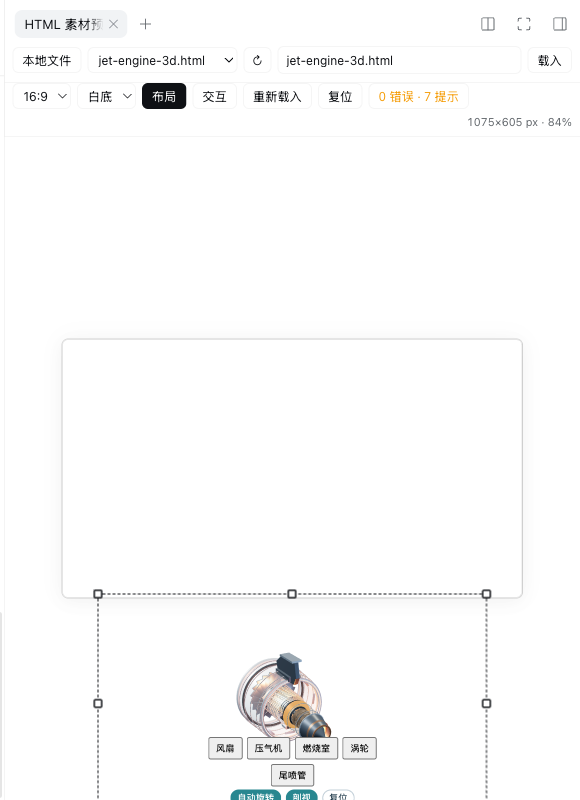

# wps-html-material · WPS 演示「HTML素材」技能

给 WPS 演示（网页版 / PC 在线文档）做**可插入幻灯片的 HTML 元素**：单文件、透明背景、跟着元素框缩放，只留必要的交互控件。

这是 `wps-html-material` skill 的仓库。技能本体是 [`SKILL.md`](SKILL.md)，按 [Agent Skills](https://code.claude.com/docs/en/skills) 的目录约定组织；本 README 是给人看的完整说明。附带一个可选的 [DSH 右侧栏插件](dsh-plugin/)，把同一份规范做成可视化预览与自检面板。

---

## 为什么需要它

WPS 的「插入 → HTML素材」只接受**一个 HTML 文件**，插入后就是幻灯片上的一个元素，可以拖动手柄改大小和位置。它默认按网页去做的东西，几乎一定会翻车：

| 你写的 | 插入 PPT 后 |
| --- | --- |
| 引 CDN 的 three.js / 字体 / 图片 | 断网或跨域，元素空白 |
| `position: fixed; inset: 0` 整页布局 | 元素盖满整个浏览器或错位 |
| 用 `100vh` / `window.innerWidth` 排版 | 元素一缩放，控件巨大或看不见 |
| 白底 / 灰色卡片 / 圆角面板 | 幻灯片上多出一块挡住的矩形 |
| 「拖动旋转 · 滚轮缩放」提示、状态字 | 元素缩到 200px 宽时变成一坨小字 |

这个 skill 把上面这些固化成**四条硬性规范 + 一套自检脚本**，让产出物一次就能插进 PPT。

## 产出物是什么

一个 `.html` 文件，在幻灯片里表现为一个透明元素框：

- 库、模型、字体、图片全部内联（base64 / data URI），不联网也能跑；
- 背景透明，幻灯片自己的底色透出来；
- 以**元素框**为视口排版：框变大变小，内容跟着重排缩放，不是固定页面；
- 只保留必要控件（按钮短标签），没有说明文字、状态行、脚注。

## 四条硬性规范

1. **单文件、完全离线**
   内联库、样式、字体、图片、模型数据。不允许 CDN、`http(s)` 资源地址、`@import`、`fetch` / `XMLHttpRequest` / 网络 `import()`。模型多大都行，内联就对了。

2. **背景透明**
   `html`、`body`、根容器、渲染器全透明。不要整页背景、渐变、卡片、边框、阴影。WebGL 要 `alpha: true` + `setClearColor(0x000000, 0)`，不要设 `scene.background`。

3. **尺寸跟随元素，不是跟随页面**
   不要 `position: fixed` 接管、不要 `100vh` / `100vw`、不要整页留白和页头页脚。
   根节点 100%，其余用容器单位和 `clamp()`；用 `ResizeObserver` 观察根节点，不用 `window.inner*`。

4. **没有小字说明**
   删掉状态行、加载提示、操作提示（「拖动旋转」「滚轮缩放」）、标题、脚注、来源声明。按钮是唯一常驻文字，短、可点、随元素缩放仍可读。

## 尺寸与适配配方

```css
html, body { margin: 0; width: 100%; height: 100%; overflow: hidden; background: transparent; }
#app { position: relative; width: 100%; height: 100%; container-type: size; }
```

```js
new ResizeObserver(() => {
  const w = canvas.clientWidth, h = canvas.clientHeight;
  canvas.width = Math.round(w * devicePixelRatio);
  canvas.height = Math.round(h * devicePixelRatio);
  camera.aspect = w / h;
  camera.updateProjectionMatrix();
  fitModel(Math.min(w, h)); // 按短边适配，留 10–15% 边距
}).observe(app);
```

- 控件、间距、字号、图标全用 `cqw` / `cqh` + `clamp()`，例如 `font-size: clamp(9px, 2.4cqw, 15px)`；
- 控件相对 `#app` 定位（如 `bottom: 4cqh`），不要相对窗口；
- 宽、方、窄高三种比例都过一遍；只对 16:9 好看的布局不算完成。

## 从整页 HTML 改造

保留交互核心（viewer / canvas / 相机 / 模型加载），删掉只为独立网页存在的东西：

1. 页头、标题、侧栏、教学文案、问题、页脚 → 删；
2. 状态字、加载字、操作提示 → 删（要加载就放无文字的 spinner）；
3. `position: fixed; inset: 0` 和 `vh` / `vw` → 换成 100% 根 + 容器单位；
4. 渲染器 `alpha: true`，`clearAlpha = 0`，不设 `scene.background`；
5. 绑定到被删节点的处理器 → 删除或判空；
6. 跑一遍自检脚本，再 `node --check` 提取出来的脚本。

## 自检

```bash
python3 scripts/check_embed_html.py your.html
```

检查项：

- **ERROR**：外部 / 相对资源 `src`、`<link>`、CSS `@import` / `url()` 走网络、动态 `import` 走网络；`position: fixed`、`100vh`、`100vw`、`window.inner*` 布局。
- **WARN**：`fetch` / `XMLHttpRequest`、外部超链接、残留提示语（拖动旋转、加载中…）、`font-size` 小于 12px、背景声明、缺显式透明背景。

有 ERROR 退出码为 1。示例文件的实际输出：

```text
== examples/rotating-cube.html
  WARN   line 47: check background is intentional: background: rgba(255, 255, 255, .74); ...
  WARN   line 57: check background is intentional: background: rgba(22, 125, 135, .92); ...
```

两条 WARN 是按钮的半透明底色，属于有意保留；没有 ERROR 就可以交付。

## 示例

[`examples/rotating-cube.html`](examples/rotating-cube.html)：约 120 行的透明线框立方体，演示容器单位、`ResizeObserver`、指针拖拽和「自动旋转 / 复位」控件，可直接插入 WPS 当模板改。自检 0 错误。

模板骨架见 [`assets/embed-template.html`](assets/embed-template.html)，尺寸 / 透明 / 常见问题细节见 [`references/embedding-guide.md`](references/embedding-guide.md)。

## 安装与使用

### Codex

把整个仓库（或其中的 `SKILL.md`、`references/`、`scripts/`、`assets/`）放进 Codex 技能目录：

```bash
git clone https://github.com/bigww41/wps-html-material.git ~/.codex/skills/wps-html-material
```

对话里输入 `$wps-html-material`，或直接说：

> 用 wps-html-material 做一个可插入 WPS PPT 的透明 HTML 元素：一个可旋转的发动机模型。

### DSH（DeepSeek Harness）

装下面的插件即可：插件激活时会把本仓库的 skill 注册为运行时技能 `wps-html-material`，资源目录指向仓库根，`references/`、`scripts/`、`assets/` 都能直接读。

## 配套 DSH 插件（可选）

[`dsh-plugin/`](dsh-plugin/) 把规范做成右侧栏工作台：放一份真实 PPT，把做好的 HTML 叠到幻灯片上预览，并用**同一套规则**自检。



- 载入 `.pptx`：插件自带 ZIP + DrawingML 读取器，把幻灯片画到 canvas，可翻页；
- 载入 `.html`：素材成为可拖动、8 向缩放的元素框，可以放在画布外；
- 「布局 / 交互」切换：布局摆位置，交互操作素材本身；
- 自检面板与 `scripts/check_embed_html.py` 对齐，带行号、可复制报告；
- 每个会话记住上次打开的 PPT 和素材。

安装：

```bash
git clone https://github.com/bigww41/wps-html-material.git
# DSH → 插件 → 添加插件 → 选择仓库里的 dsh-plugin/ 目录
```

## 目录结构

```
SKILL.md                    技能本体（规范 + 工作流）
references/embedding-guide.md   尺寸、透明、失败模式与适配清单
scripts/check_embed_html.py     交付前自检
assets/embed-template.html      透明自适应的最小骨架
agents/openai.yaml              Codex 界面元数据
examples/rotating-cube.html     可直接插入的示例
dsh-plugin/                     DSH 右侧栏插件（PPT 画布 + 预览 + 自检）
```

## 不适用

- 完整网站、需要多页跳转的页面；
- 依赖登录、后端接口或实时数据的页面；
- 需要 WPS 之外浏览器窗口铺满的场景。

## 变更

见 [dsh-plugin/docs/CHANGELOG.md](dsh-plugin/docs/CHANGELOG.md)。
