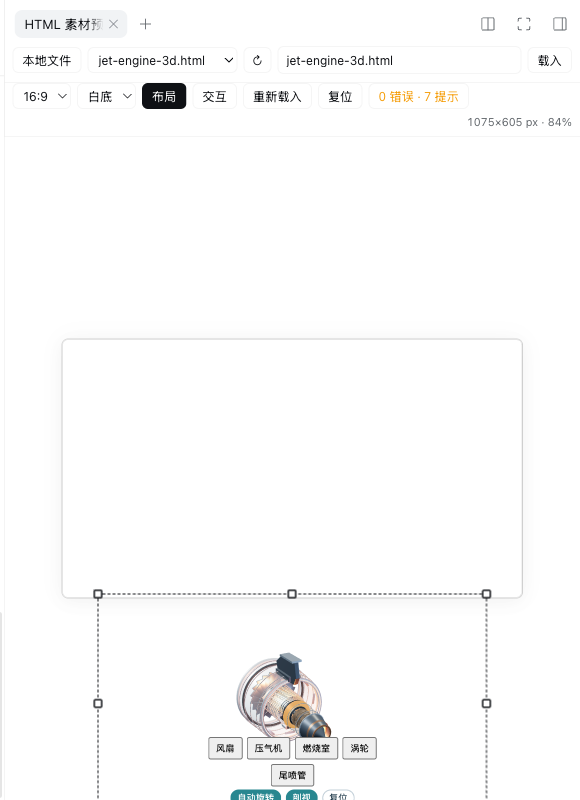

# WPS HTML 素材预览 · DSH 插件

右侧栏工作台：放一份真实 PPT，把做好的单文件 HTML 素材叠到幻灯片上预览，
并用 `wps-html-material` 的同一套规则自检。

仓库根目录是 [skill 本体](../SKILL.md)；本目录是它的 DSH 图形界面。



## 安装

```bash
git clone https://github.com/bigww41/wps-html-material.git
```

DSH → 插件（Plugins）→ 添加插件 → 选择仓库里的 `dsh-plugin/` 目录
（或 `dsh plugin add <path>`）。装好后：

- 会话标题栏右侧出现幻灯片按钮；
- 右侧栏引导 / 添加菜单里出现「HTML 素材预览」；
- profile 有 skills 服务时，仓库根部的 `wps-html-material` 技能会注册为运行时技能。

## 用法

1. 打开面板，顶部「工作区文件」选 `.pptx`，或用「本地文件」。
2. 幻灯片画在画布上，`‹ 2 / 14 ›` 翻页。
3. 再选 `.html`：素材成为可拖动、可缩放的元素框，8 个手柄。
4. 「布局 / 交互」：布局摆位置和大小；交互把指针交给素材本身。
5. 元素框可以拖到画布外（灰色工作区），「复位」回默认位置。
6. 「0 错误 · 7 提示」展开自检：外部资源、整页布局、网络调用、残留小字、
   字号、背景声明，带行号，可复制报告。

## 实现要点

- **PPTX**：ZIP 中央目录 + `DecompressionStream('deflate-raw')`，自写 DrawingML
  读取器；绘制背景、矩形 / 椭圆、图片（含裁剪）、文本（字号 / 粗细 / 颜色 /
  对齐 / 内边距）。
- **无外部依赖**：客户端只 `require('react')`，不引 CDN、不装库。
- **隔离**：素材在 `sandbox="allow-scripts"` 的 blob iframe 里运行，拿不到宿主页面。
- **缓存**：会话级 LRU（素材 4 份、PPT 2 份），淘汰时释放 Blob URL。
- **自检对齐 skill**：插件与仓库的 `scripts/check_embed_html.py` 用同一套规则，
  同一份文件结论与行号一致。

## 目录结构

```
client.js          右侧栏页面：PPTX 渲染、素材层、自检
index.js           Host 半边：定位并注册 wps-html-material 技能
cordis.patch.yml   插件行
locale/            插件标题 / 描述 / 详情（中英）
docs/              详情图、变更记录、截图
icon.svg
```

`index.js` 先找包内的 `skill/SKILL.md`（把本目录单独复制出去时），
找不到再用上一级的 `../SKILL.md`（本仓库布局），资源目录随之指向 skill 根。

## 限制

- 只读：不写文件、不上传；预览裁切与 WPS 一致（元素超出幻灯片的部分放映时不显示）。
- PPT 渲染是预览级：主题 / 版式继承、渐变、效果、表格、SmartArt、多层组合不画；
  文字按字符换行；旧版 `.ppt` 不支持，请另存为 `.pptx`。

## 变更

见 [docs/CHANGELOG.md](docs/CHANGELOG.md)。

---

**English**: A DeepSeek Harness right-Sidebar workbench for WPS Presentation
HTML素材. It renders a `.pptx` on a canvas, places a single-file HTML element on
the slide — or outside it — and runs the skill's embed self-check. The skill
itself lives at the repository root; `index.js` locates it there (or in a
sibling `skill/` copy) and registers it as a runtime skill.
